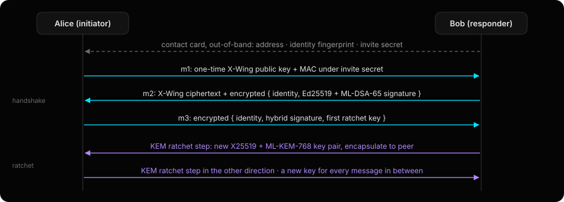
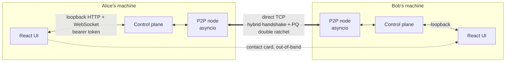

# PQ-Chat

Serverless, end-to-end encrypted messaging with a hybrid post-quantum handshake and a post-quantum double ratchet.

Two nodes connect directly over TCP. There is no server, no account and no directory: peers find each other by exchanging a short contact card over a channel they already trust. Every session key is derived from **X25519 and ML-KEM-768 together**, both sides authenticate with **Ed25519 and ML-DSA-65 together**, and keys roll forward with every message.

All cryptography uses real, standardised primitives from `cryptography` (OpenSSL). Nothing is mocked. The hybrid KEM is [X-Wing](https://datatracker.ietf.org/doc/draft-connolly-cfrg-xwing-kem/) and passes that draft's official test vectors.



## Why hybrid

An attacker can record encrypted traffic today and decrypt it once a large quantum computer exists ("harvest now, decrypt later"). Classical key exchange such as X25519 offers no protection against that. ML-KEM (FIPS 203) does, but it is young, and lattice schemes have had less cryptanalysis than elliptic curves.

Combining the two means an attacker has to break both. The same reasoning is applied to authentication: a forged identity needs a forged Ed25519 signature *and* a forged ML-DSA-65 (FIPS 204) signature.

| Purpose | Classical | Post-quantum | Combined as |
| --- | --- | --- | --- |
| Key agreement | X25519 | ML-KEM-768 | X-Wing: `SHA3-256(ss_M ‖ ss_X ‖ ct_X ‖ pk_X ‖ label)` |
| Authentication | Ed25519 | ML-DSA-65 | Both signatures must verify |
| Encryption | ChaCha20-Poly1305 | (256-bit keys) | |
| Key derivation | HKDF-SHA256, HMAC-SHA256 | | |

## System architecture



| Module | Responsibility |
| --- | --- |
| `pqchat/hybrid.py` | X-Wing KEM (X25519 + ML-KEM-768) |
| `pqchat/identity.py` | Hybrid signing identity, encrypted keystore, contact cards, safety numbers |
| `pqchat/handshake.py` | Authenticated key agreement, sans-IO state machines |
| `pqchat/ratchet.py` | Post-quantum double ratchet, padding |
| `pqchat/wire.py` | Length-prefixed framing with a hard size limit |
| `pqchat/node.py` | TCP listener/dialler, sessions, in-memory history |
| `pqchat/control.py` | Loopback API and WebSocket for the UI |
| `web/` | React + Tailwind interface |

## Protocol

### 1. Out-of-band contact card

```
pqchat1:<base64url( host ‖ port ‖ SHA-256(identity keys) ‖ invite secret ‖ checksum )>
```

About 95 characters. It does two jobs: it **pins** the owner's identity (so the dialler knows exactly whose signature to expect) and it carries a 128-bit **invite secret** that authorises its holder to connect. The card never crosses the network. Revoking it generates a new secret and leaves existing sessions untouched.

### 2. Handshake

```
I → R   m1 = version ‖ nonce_i ‖ eph_pk_i ‖ HMAC_psk(m1)
I ← R   m2 = nonce_r ‖ kem_ct ‖ AEAD_kr( id_r , sig_r(th2) )
I → R   m3 = AEAD_ki( id_i , sig_i(th3 ‖ ratchet_pk_i) , ratchet_pk_i )
I ← R   first ratchet message (key confirmation)
```

It follows the SIGMA-I pattern with a KEM in place of Diffie-Hellman, and the invite secret mixed into the key schedule as a pre-shared key.

- **Hybrid secrecy** – `kem_ct` is an X-Wing encapsulation to a one-time key.
- **Mutual authentication** – hybrid signatures over a running transcript hash, so a signature is useless in any other handshake. The initiator checks the responder against the pinned fingerprint *before* verifying the signature.
- **Identity hiding** – long-term keys are only ever sent encrypted. Since the handshake keys depend on the invite secret, even an active attacker who does not hold the card cannot learn who is listening.
- **DoS and probe resistance** – `m1` carries a MAC under the invite secret. Without it the responder closes the connection before doing any public-key operation and without sending a byte, so a port scan reveals nothing.

### 3. Post-quantum double ratchet

Signal's Double Ratchet, with the Diffie-Hellman step replaced by an X-Wing encapsulation.

- **Symmetric ratchet (every message).** Each message key comes from a chain key that is replaced immediately with a one-way function. Compromising a device does not expose earlier messages.
- **KEM ratchet (every change of direction).** The sender generates a fresh hybrid key pair and encapsulates to the peer's newest one; the result is mixed into the root key. An attacker who copied a device's entire state is locked out again once that device has ratcheted in a key pair the attacker never saw. Both X25519 and ML-KEM-768 contribute to every step, so this healing is post-quantum too.

Other details:

- Header (`ratchet_pk ‖ kem_ct ‖ pn ‖ n`) and session id are authenticated as AEAD associated data.
- Decryption runs on a copy of the state and is committed only if the tag verifies. A forged frame cannot desynchronise the ratchet.
- Out-of-order messages are supported with bounded skipped-key storage (256 per chain, 1024 total), so a hostile counter cannot force unbounded work.
- Plaintext is padded to 256-byte buckets, hiding exact message lengths.
- Any authentication failure on the wire terminates the session.

### 4. Safety number

Sixty digits derived from both identity fingerprints. Reading it aloud confirms neither side was handed a substituted card.

## Threat model

| Threat | Mitigation |
| --- | --- |
| Passive eavesdropper, including one with a future quantum computer | X-Wing hybrid KEM for the handshake and every ratchet step |
| Active man-in-the-middle on the TCP path | Fingerprint pinned by the card, hybrid signatures over the transcript, invite secret in the key schedule |
| Impersonation by breaking one signature scheme | Ed25519 and ML-DSA-65 must both verify; the signed data names the full identity key |
| Later compromise of a device (forward secrecy) | Ephemeral handshake keys; chain keys overwritten after every message |
| Temporary compromise of a device (post-compromise security) | KEM ratchet injects fresh hybrid secrets on every turn |
| Tampering, replay, reordering, cross-session injection | AEAD over ciphertext, header and session id; per-message keys are single use |
| Unknown-key-share / identity misbinding | Signatures cover the transcript; identities are sent under keys derived from it |
| Network scanning and unauthenticated DoS | MAC on the first message, silent drop, 10 s handshake timeout, session cap, 32 KiB frame limit |
| Small-order X25519 points, malformed ML-KEM keys | Rejected by the library checks; covered by tests |
| Traffic analysis of message length | Fixed-size padding buckets |
| Malicious web page talking to the local UI server | Loopback bind, per-launch bearer token in the URL fragment, Host and Origin checks, token as first WebSocket frame |
| XSS through message content | React text rendering plus a CSP with `default-src 'none'` and no inline script or style |
| Theft of the identity file | scrypt (N = 2^15) + ChaCha20-Poly1305; passphrase never taken from the command line |

**Not protected against:** malware on an endpoint while it is in use, metadata visible to the network (who connects to whom, when, and roughly how much), and denial of service by someone who controls the network path. IP addresses are exposed to the peer by design, since the connection is direct.

## Installation

Requires Python 3.11+ and Node.js 20+ (Node is only needed to build the UI and run browser tests).

```bash
python -m venv .venv
source .venv/bin/activate          # Windows: .venv\Scripts\activate
pip install -r requirements-dev.txt

npm install
npm run build                      # builds the UI into web/dist
```

### Try it on one machine

Open two terminals:

```bash
python -m pqchat --name alice --port 9001 --ui-port 8081
python -m pqchat --name bob   --port 9002 --ui-port 8082
```

Each prints a link such as `http://127.0.0.1:8081/#token=…`. Open both, copy Bob's contact card into Alice's "Connect to a peer" box and start typing. The **Cryptographic state** panel shows the active algorithms, a hash of the current sending key (it changes with every message), the ratchet epoch and the safety number.

### Across a network

```bash
python -m pqchat --host 0.0.0.0 --advertise 192.168.1.20 --port 9001 --identity alice.pqid
```

`--identity` stores the long-term keys in a passphrase-encrypted file so the fingerprint survives restarts. Without it the identity is ephemeral. The web UI always binds to loopback only.

## Tests

```bash
pytest               # 96 tests
npm run test:e2e     # 13 Playwright tests: two real nodes, two browsers
```

What the suites cover:

- **Known-answer tests** for X-Wing against the IETF draft vectors.
- **Handshake**: agreement, fresh keys per session, strangers dropped before any reply, identities absent from the wire, impersonation, tampering with every message, cross-handshake replay.
- **Ratchet**: unique key per message, KEM step on direction change, forward secrecy, post-compromise healing (with a cloned state acting as the attacker), reordering, late messages across epochs, replay, bit flips in every header field, state unchanged after a forgery, skip limits, padding.
- **Network**: a recording proxy asserts the plaintext and identities never appear on the wire; a tampering proxy asserts a single flipped bit closes the session; garbage and oversized frames get no response.
- **Control plane**: bearer token, DNS rebinding, cross-origin requests, security headers, input validation, WebSocket authentication.
- **Browser**: full conversation between two nodes, key hash rolling forward, ratchet epoch advancing, HTML in messages rendered as text, locked UI without a token.

## Design notes and limitations

- **Header size.** Each message carries a 1216-byte ratchet public key and a 1120-byte ciphertext. That is the price of doing a full hybrid KEM ratchet every turn. Signal's SPQR amortises this by spreading the key over many messages; that would be the next optimisation here.
- **Not constant-time end to end.** The primitives are OpenSSL's constant-time implementations, but Python cannot guarantee secrets are wiped from memory.
- **No offline delivery.** Both peers must be online. There are no prekeys because there is no server to hold them.
- **One device per identity**, and no group chats.
- **Unreviewed.** This is a study of how these protocols fit together, tested as carefully as I could, but it has not had an independent audit and should not carry anything that matters.

## Real-world relevance

NIST finalised ML-KEM and ML-DSA in August 2024, and hybrid deployment is how the industry is adopting them: TLS 1.3 uses X25519MLKEM768 in major browsers, Signal moved to PQXDH and then added a post-quantum ratchet, and Apple shipped PQ3 for iMessage. PQ-Chat implements the same ideas at a size that can be read in an afternoon: a hybrid KEM with a proper combiner, hybrid authentication, a transcript-bound handshake, and a ratchet that keeps its post-compromise guarantees against a quantum adversary.

## References

- FIPS 203 (ML-KEM), FIPS 204 (ML-DSA), NIST, 2024
- Barbosa et al., *X-Wing: The Hybrid KEM You've Been Looking For*, and draft-connolly-cfrg-xwing-kem
- Krawczyk, *SIGMA: the 'SIGn-and-MAc' Approach to Authenticated Diffie-Hellman*, 2003
- Perrin and Marlinspike, *The Double Ratchet Algorithm*, Signal, 2016
- Kret and Schmidt, *The PQXDH Key Agreement Protocol*, Signal, 2023
